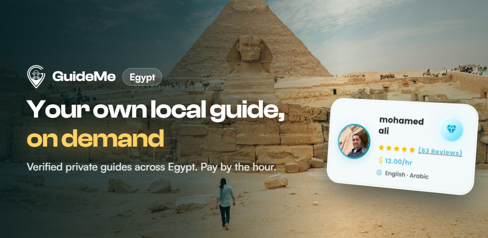
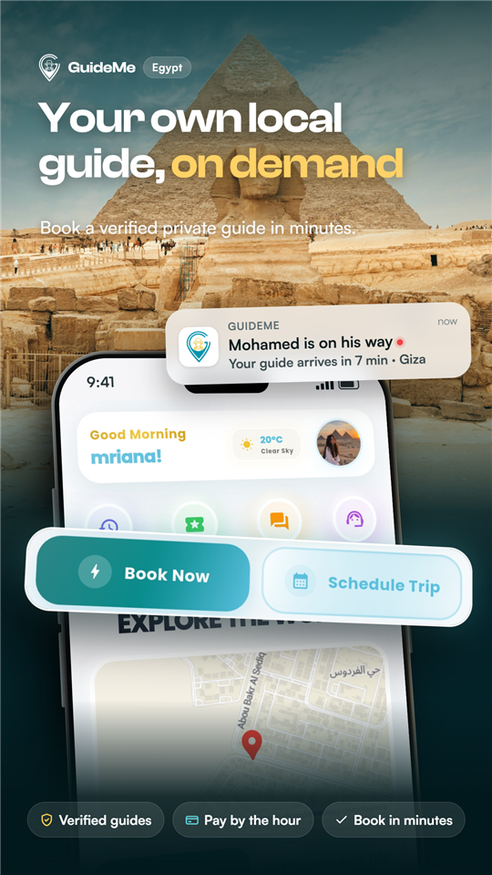
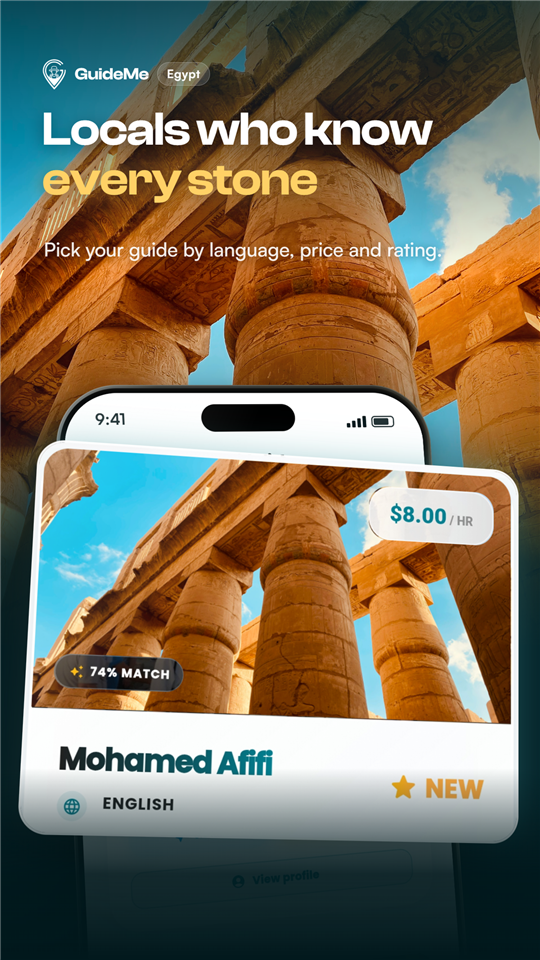
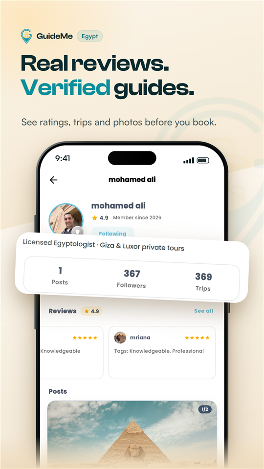
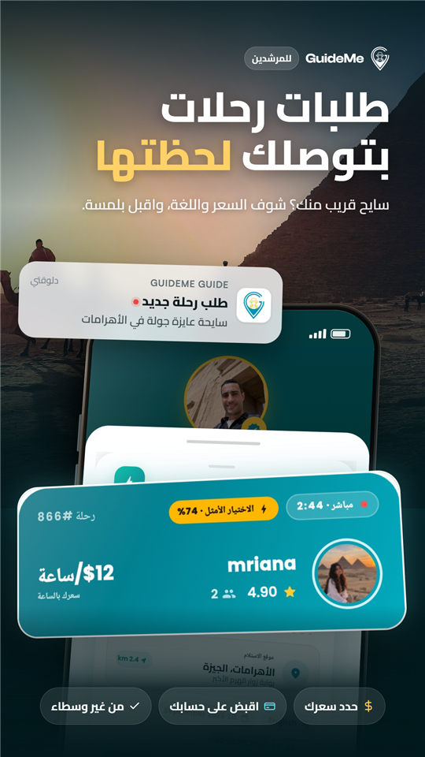
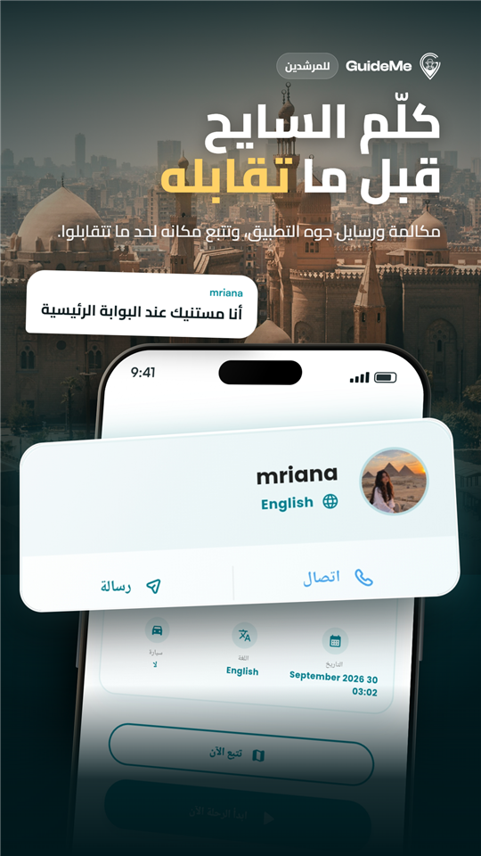
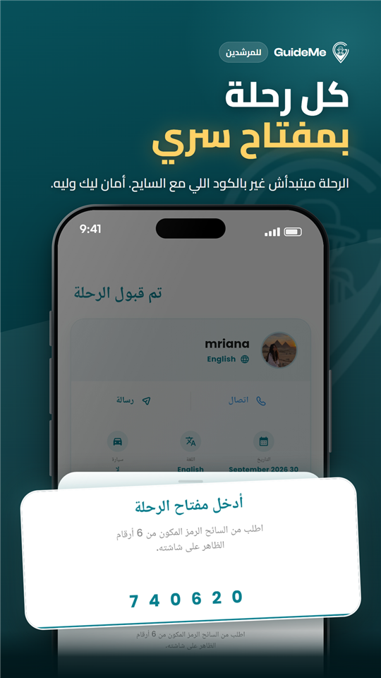
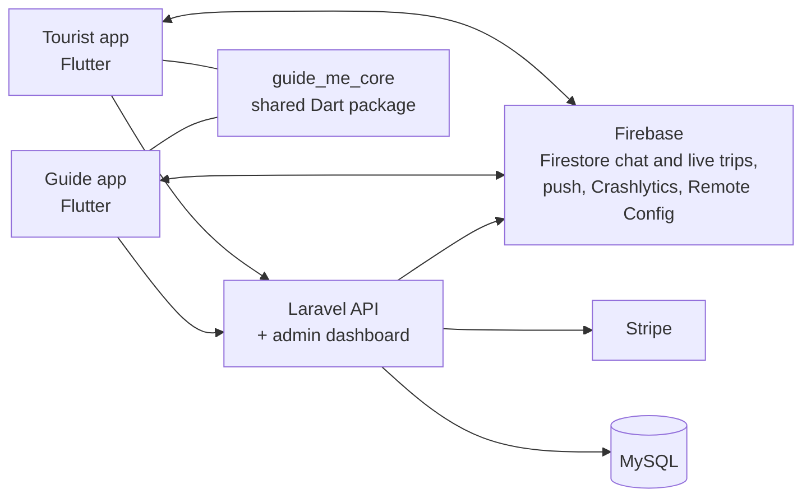

# GuideMe: case study

GuideMe connects tourists in Egypt with licensed local guides. You open the app, pick a guide by language, price and rating, and book them for now or for a later date. You can watch the guide come to you on the map, chat with them, and pay by card or cash. I write the code for both mobile apps, the API, the admin dashboard and the website, and I handle the store releases. I work with AI coding tools.

The source code is private because it is a live business. This repository shows what the product does and how it is built. If you are thinking about hiring me, I can give you a walkthrough of the real code on a call.

## Live

- Website: [guideme-eg.com](https://guideme-eg.com) (English and Arabic)
- Tourist app: [Google Play](https://play.google.com/store/apps/details?id=guide.me.user) and the App Store
- Guide app: [Google Play](https://play.google.com/store/apps/details?id=guide.me.tour) and the App Store

## In numbers (November 2026)

- 2 apps on 2 stores (Android and iOS), from one Flutter codebase per app and a shared core package
- 12 languages in the tourist app, including Arabic with full right-to-left layout
- 25 partner hotels and hostels signed up to the referral program (October 2026)
- 95 automated tests that run before every push and again on GitHub Actions
- 356 commits in the current repository (since June 2026)

## The tourist app

  
  
  

- You can book a guide right now or schedule one for a later date. A scheduled booking counts as accepted when the guide confirms it, not when its status changes.
- Matching is by language, price and rating, and each guide card shows a match percentage.
- The guide's arrival is tracked live on a map, and the trip timer runs on the server's clock, not the phone's. That stops the timer from jumping and stops trips from being counted as the wrong type.
- You can chat in the app and get push notifications in your own language.
- You can pay by card (Stripe) or in cash. A cancellation fee is added to your next trip instead of being charged right away.
- Partner hotels get a code. When their guests use it, the guest gets a discount and the hotel earns a commission.
- There is a visual mode for deaf travellers. Guides can say which sign languages they use, and requests from deaf travellers are flagged for them.

## The guide app

  
  
  

- Guides get trip requests in real time, see the price, distance and match score, and accept or decline.
- They can call or message the tourist before meeting, and a trip only starts once the guide enters the 6-digit key shown on the tourist's phone.
- They upload their ID and licence and wait for approval. Once approved, the ID is locked and can only be changed after a 48-hour unlock.
- They have a wallet with their trip history and can request a withdrawal.
- Strikes for no-shows and late cancellations follow a written policy.

## How it is built

- **Apps:** Flutter, using BLoC/Cubit for state and a shared `guide_me_core` package for networking, auth and the server clock.
- **Backend:** Laravel (PHP 8.3) with MySQL. The same Laravel project serves the REST API and an Arabic and English admin dashboard (trips, guides, partners, payouts, promo codes).
- **Realtime:** Firestore for chat and live trip state, and Firebase Cloud Messaging for push notifications.
- **Releases:** apps go through the stores, and urgent fixes go out as Shorebird code-push patches the same day. Remote Config handles maintenance mode, feature flags and forced updates.
- **Website:** static and fast, on Firebase Hosting, in English and Arabic.

## How I work

Every change:

1. gets a dated line in the changelog for the part it touches. A git hook refuses the commit without one.
2. names the test that covers it. The pre-push hook runs the tests for every part touched, and GitHub Actions runs them all again.
3. ships with a release note and a rollback plan. Incidents get a written post-mortem, and big decisions get a written decision record.

The backend tests run against a real MySQL database built from the staging schema, not against mocks of the database.

## What I can build for you

The same work, for your idea: a mobile app for Android and iOS, the backend and dashboard behind it, payments, live maps and chat, and the release work all the way to the stores.

**Contact:** support@guideme-eg.com
